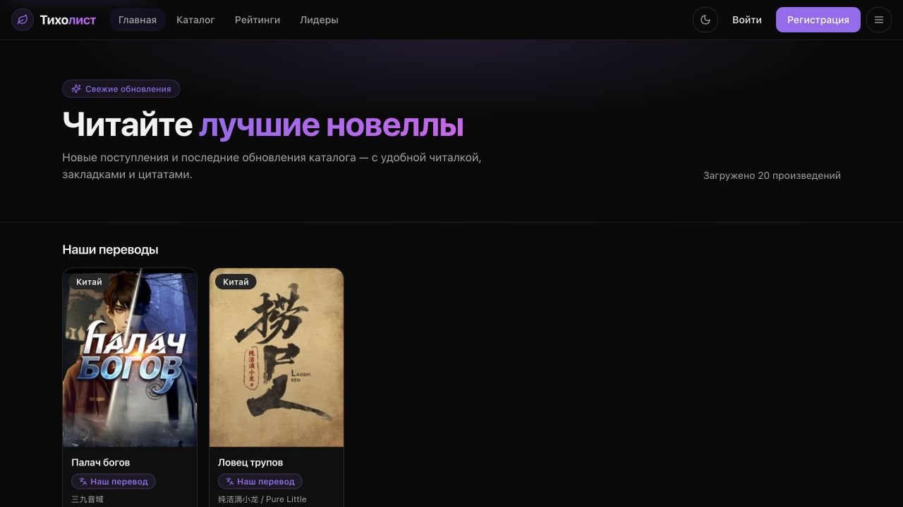
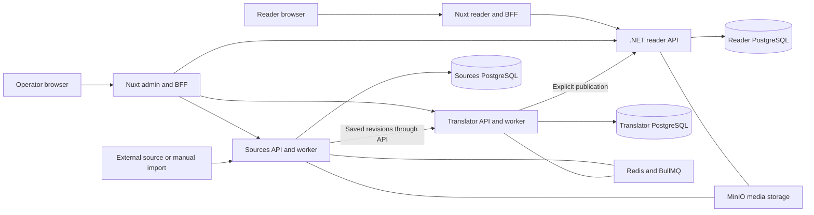

# Tiholist

A live reading platform with a separate content acquisition, translation, and publication workflow.

**[Open tiholist.app](https://tiholist.app) · [Engineering decisions](docs/engineering.md) · [Verification and public code](docs/verification.md)**

| | |
| --- | --- |
| Role | Sole developer and maintainer |
| Scope | Product flows, frontend, backend APIs, background workers, deployment, and recovery tooling |
| Main stack | TypeScript, Vue / Nuxt, C# / .NET 10, EF Core, Prisma, PostgreSQL, Redis / BullMQ, MinIO, Docker Compose |
| Status | Live and under active development |
| Earlier name | LibNode; existing internal identifiers retain that name for compatibility |

## The product

Tiholist brings catalog discovery and long-form reading together with the tools needed to prepare and publish text. Readers can keep their place, organize shelves, save bookmarks and quotes, and choose between available text versions.

Behind the reader is an operator workflow: acquire and retain source chapters, prepare translations with a glossary, review versions, and explicitly publish selected results. Acquisition, processing, and publication have separate state and can fail independently.

As the sole developer, I own the implementation and maintenance across those boundaries. This case focuses on the choices that keep saved work intact as the product evolves.

## Decisions worth reviewing

| Problem | Decision | Why it matters |
| --- | --- | --- |
| Upstream text can change after translation | Retain immutable source snapshots and link translations to their exact input | A change can mark a translation stale while preserving its history |
| Delivery can time out after a remote write succeeds | Persist publication intent, pin a revision, and use a stable reader version key | Retrying can reconcile an existing result without creating duplicate versions |
| Operators can edit a published chapter manually | Treat existing hidden or manually edited versions as retained data | Recovery avoids silently overwriting editorial work |
| Browser clients need authenticated API access | Put the reader session token behind a Nuxt BFF and an HttpOnly cookie | The browser receives user data while service credentials stay on the server |
| A successful backup command is insufficient evidence of recovery | Provide isolated restore verification and integrity checks | Recovery is an executable workflow with explicit failure handling |

[Read the failure scenarios and trade-offs →](docs/engineering.md)

## Architecture

Each application owns its schema, migrations, dependencies, and build. Services exchange IDs and JSON through authenticated APIs. Independent data ownership helps keep acquisition, translation, and reader publication separate; it also adds deployment and recovery complexity that must be handled explicitly.

## SEO as part of product engineering

Public pages render on the server and expose canonical URLs, Open Graph metadata, and structured data. The reader produces a sitemap index with bounded chapter, book, and taxonomy pages. Private account routes are excluded from crawler instructions.

The live [robots.txt](https://tiholist.app/robots.txt) and [sitemap index](https://tiholist.app/sitemap.xml) can be inspected directly. These endpoints and the homepage metadata were checked on October 27, 2026. Search visibility and traffic are separate product outcomes to measure as the service develops.

## Verification snapshot

The following application suites passed locally on **October 27, 2026**, using Node.js 24 and development snapshot `e6e9de3`:

| Application | Passing tests | Scope |
| --- | ---: | --- |
| Reader web | 255 | Unit and component checks for reader state, navigation, SSR behavior, and API boundaries |
| Translator | 926 | Unit and mocked API checks for revisions, glossary processing, publication, and job behavior |
| Sources | 152 | Unit and mocked adapter/API checks for acquisition, normalization, and outbound URL policy |

Docker acceptance, live database integration, .NET tests, browser E2E, and restore verification are separate checks. They were outside this local run. The snapshot records a specific verification result rather than a continuously updated CI status.

[See commands, limitations, and public implementation examples →](docs/verification.md)

## Code availability

The current application is maintained in a private monorepo. Earlier LibNode reader API, reader frontend, and deployment repositories remain public, with their original history. The [verification guide](docs/verification.md#public-code-to-inspect) links to specific implementation and test files at fixed commits.

A technical walkthrough can cover the current revision model, queue recovery, authentication boundary, and release process. This public case describes the design without exposing production credentials, private infrastructure addresses, or operational data.
